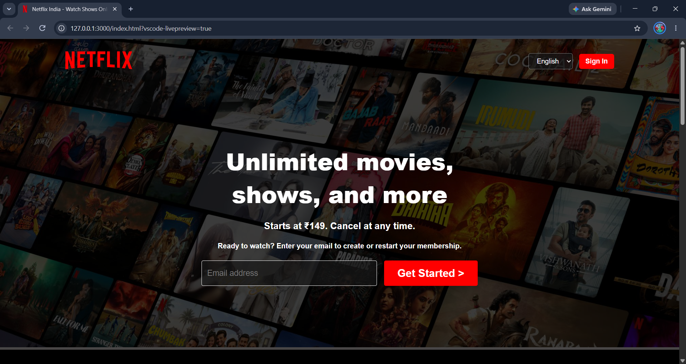
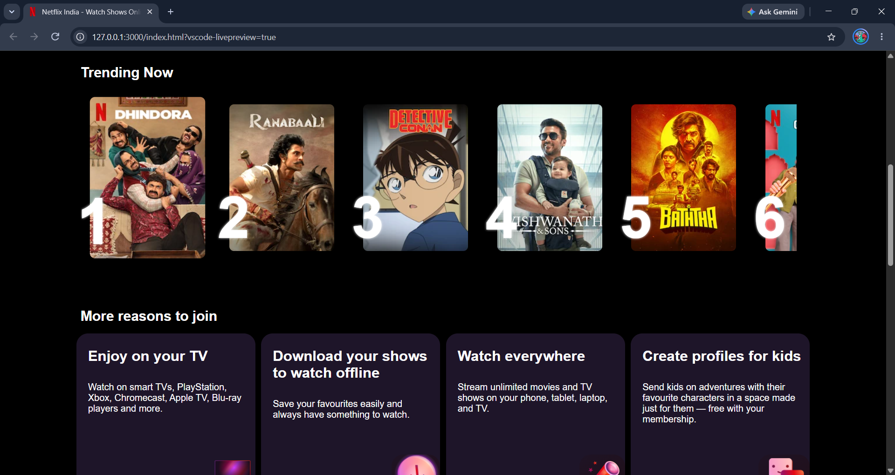
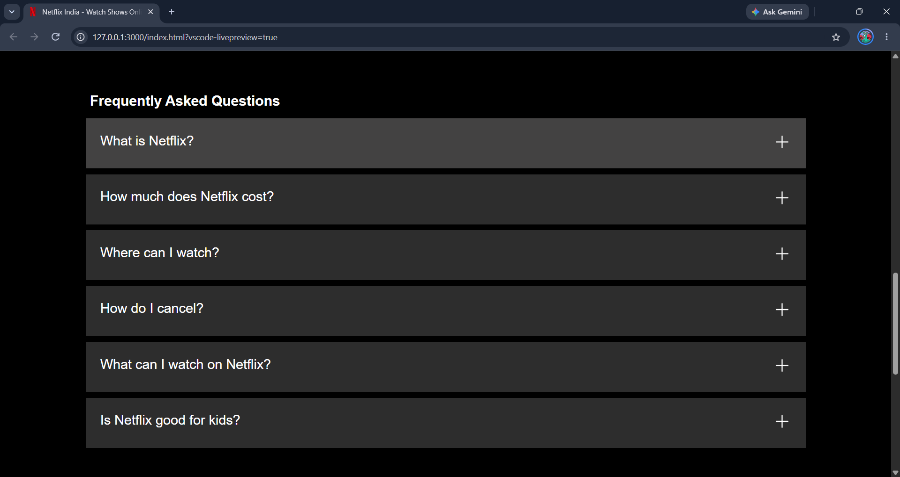
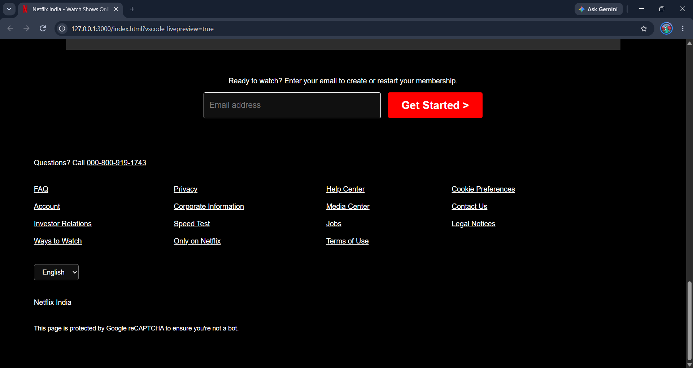

🎬 Netflix Clone

A Netflix-inspired website UI built using HTML and CSS only. This project recreates the look and feel of Netflix's landing page, focusing on layout, styling, responsiveness, and visual design.

🚀 About the Project

This is a frontend clone of Netflix created as a personal web development project. I built the entire website myself using only HTML and CSS, without using JavaScript or AI for the actual development.

The project helped me improve my understanding of:

- HTML structure and semantic elements
- CSS styling and layouts
- Flexbox
- Positioning and layering
- Background images and overlays
- Responsive design
- UI recreation and visual accuracy

🛠️ Technologies Used

- HTML5
- CSS3

✨ Features

- Netflix-inspired user interface
- Dark theme design
- Hero section with background image
- Navigation bar
- Movie and series sections
- Hover effects
- Custom styling and layouts
- Responsive design (For Mobile Phones Only)

📸 Preview

📂 Project Structure

Netflix-Clone/
│
├── index.html
├── style.css
├── Assets/
│   └── Images
├── Screenshots
└── README.md

▶️ How to Run

1. Clone this repository:
   
   git clone https://github.com/your-username/netflix-clone.git

2. Open the project folder.

3. Open "index.html" in your browser.

That's it! No installation or dependencies required.

🎯 Purpose

The main purpose of this project was to practice frontend development and improve my CSS skills by recreating a real-world website interface.

👨‍💻 Developer

Built entirely by me using HTML and CSS.

No AI was used to build the website — just my own coding, learning, debugging, and creativity.

Well... AI did help me write this README. 😅

---

⭐ If you like this project, feel free to star the repository!

Disclaimer: This project is made for educational purposes only. Netflix is a registered trademark of Netflix, Inc.